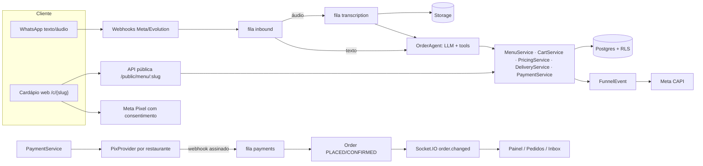

# Cardápio digital com IA: plano

Data: 21/11/2026. Fontes: `prompt-cardapio-ia-dishdesk.md` (pedido do usuário), `jornada de compra cardapio web.pdf` (vistoria do cardápio da Aglio Nero no Cardápio Web, 20/11/2026) e ROADMAP.md, Fase 5 (E41 a E44).

Este plano corresponde à tarefa 1: planejar e levantar as telas. Não há código, migration nem design. As telas para o Claude Design estão em [TELAS.md](TELAS.md), e as tarefas, em [TAREFAS.md](TAREFAS.md).

## 0. Conflitos entre o prompt, o repositório e o CLAUDE.md

Os conflitos abaixo foram encontrados antes de qualquer código. Cada um traz a saída proposta.

| # | Conflito | Saída proposta |
|---|---|---|
| C1 | O prompt manda "corrigir os erros do arquivo da jornada". Os erros do PDF, porém, são do **Cardápio Web** (outro produto), não do Dish Desk. | A Fase 1 passa a ser uma **lista de requisitos "não reproduzir"** (seção 3). Cada erro vira um critério de aceite e um teste nas fases 2, 3 e 6. Não há bug nosso para corrigir. |
| C2 | O prompt pede commits por fase. O CLAUDE.md §5 proíbe commit sem pedido explícito. | Cada tarefa termina testada e sem commit. O usuário pede o commit, ou autoriza de forma permanente commits por tarefa neste módulo. |
| C3 | O prompt cita botões e listas interativas, `order_details` com Pix e o `referral`/`ctwa_clid`. O WhatsApp em produção é a **Evolution API (QR Code)**, e os três recursos só existem na **API oficial** (Cloud API). | Fazer o fluxo com **texto numerado** ("Responda 1, 2 ou 3"), que funciona nos dois conectores. Os botões nativos ficam atrás de `connector.capabilities.interactive`, ligados só na Cloud API. A atribuição do CTWA ao anúncio depende de voltar para a API oficial (decisão D6). |
| C4 | O prompt diz para usar o provedor de LLM do projeto. O `LlmClient` só gera JSON estruturado, **sem tool calling**, e o Ollama foi abandonado em 15/11. | Criar `LlmProvider` com tool calling, implementado sobre o `@anthropic-ai/sdk` que já está no projeto (D1). O custo continua em `AiUsage`. |
| C5 | O status do prompt (`rascunho → aguardando_pagamento → pago…`) não bate com o `OrderStatus` atual (PLACED, CONFIRMED, PREPARING, READY, DISPATCHED, DELIVERED, CANCELED). | O carrinho e o pagamento ficam em modelos próprios (`Cart` com DRAFT, AWAITING_CONFIRMATION, CHECKED_OUT, ABANDONED; `Payment` com PENDING, PAID, EXPIRED, REFUNDED). O `Order` só nasce **pago**, ou confirmado quando o pagamento é na entrega, e usa o `OrderStatus` que já existe. Assim os cards, o fraude (E40) e a previsão (E26) continuam iguais. |
| C6 | O app não guarda mídia: `message-media.ts` baixa o arquivo da plataforma a cada pedido. O módulo precisa de fotos dos itens, de áudio guardado e do QR do Pix. | Criar um storage de objetos (Supabase Storage ou Cloudflare R2), decisão D3. É pré-requisito das fases 2 e 5. |
| C7 | O CLAUDE.md §7 diz que o MVP é só desktop. O cardápio público é, por natureza, **mobile-first**, porque abre no navegador do WhatsApp e do Instagram. | O cardápio público é mobile-first, com uma versão desktop (sacola lateral, item copiado do PDF). As telas do painel seguem desktop. |
| C8 | O CLAUDE.md §8 manda não construir tela sem design. | Nenhuma tarefa de UI começa antes de o board correspondente existir no `Dish Desk Design.html` (ver TELAS.md). As tarefas de backend podem andar antes. |
| C9 | O prompt pede uma tabela `funnel_events`. Já existe `SiteVisit` (analytics da landing). | Criar `FunnelEvent` à parte (por restaurante, com RLS) e não misturar com a landing. |

## 1. O que já existe e pode ser reaproveitado

- **Multi-tenant:** `withTenants()` (`packages/database/src/index.ts`), migrations SQL escritas à mão com a política `tenant_isolation` e o teste `packages/database/test/tenant-isolation.test.ts`.
- **Configurações:** `Tenant.settings` (Json), validado por zod em `packages/shared/src/settings.ts`. Já tem `businessHoursOf` (horário), a previsão de pedido (E26), a pausa e a personalidade.
- **Pedido:** `Order`, `OrderItem`, `OrderEvent` e `Rating`. A fraude (`orders/fraud-alert.ts`, Jev), a previsão (`orders/forecast.ts`), o histórico do cliente e o `order-notice.service.ts` já existem.
- **Cliente:** `Contact` (telefone E.164), `ContactAddress`, `Consent` (opt-in) e as tags.
- **IA:** `ai-attendant.service.ts` (prompt por restaurante, handoff), `Conversation.automationState.ai` (liga e desliga por conversa), `AiUsage` (custo) e `AutomationMessages` com `fillMessage` (§10).
- **WhatsApp:** `whatsapp.connector.ts` (Cloud API) e `evolution.connector.ts` (com `sendMedia`), `fetchMedia` nos dois e as filas `inbound`/`outbound`.
- **Filas:** BullMQ (`queues.module.ts`). Entram as filas novas `menu`, `transcription`, `payments` e `funnel`.
- **Tempo real:** Socket.IO com `inbox.changed`. Entram `order.changed` e `cart.changed`.
- **Criptografia:** `encrypt`/`decrypt` (AES-256-GCM) em `packages/database/src/crypto.ts`, que serve para as credenciais do Pix e da Meta.
- **Pix:** `billing/infinitepay.ts` é Pix da assinatura do Dish Desk. Serve de referência de webhook, não de cobrança por restaurante.
- **Slug:** `Tenant.slug` é único e serve para a rota pública `/{slug}`.

## 2. Arquitetura

Regras de arquitetura:

- **Preço só no servidor.** O `PricingService` é a única função que calcula subtotal, complementos, meio a meio, taxa, cupom e total. O agente e o site só mostram o que ele devolve.
- **Mesmo carrinho nos dois canais.** O `Cart` fica ligado ao `contactId`, ou a um `sessionToken` no site. O link `?c=<token assinado>` liga os dois.
- **O agente só muda dado por ferramenta.** O texto do cliente nunca entra como instrução. Cada ferramenta recebe o `tenantId` da conversa, nunca do LLM.
- **Pedido só vai para a cozinha pago** (ROADMAP E43). Comprovante enviado pelo cliente não vale.

## 3. Erros do PDF: requisitos "não reproduzir"

Causa: decisão de produto do Cardápio Web. Onde vale: o módulo novo. A correção é o requisito do Dish Desk.

| # | Gravidade | Erro no Cardápio Web | Requisito no Dish Desk | Onde (tarefa) |
|---|---|---|---|---|
| R1 | Crítico | Login só com o telefone, sem código. O mesmo campo libera o checkout e expõe pedidos, pontos e endereço. | Código de uso único (OTP) pelo WhatsApp do restaurante, ou por SMS como alternativa, antes de mostrar dado salvo. Checkout de visitante sem OTP é permitido, mas não mostra endereços nem histórico salvos. Teste: telefone sem OTP não lê dado. | F3-05 |
| R2 | Alto | Não dá para agendar, nem com a loja fechada nem aberta. | Pedido agendado: com a loja fechada, "Abre às 18h, agendar"; com a loja aberta, faixas de horário. O horário escolhido aparece no resumo e no card do pedido. | F2-06, F3-08 |
| R3 | Alto | A validação do endereço é a do navegador, em inglês, um campo por vez. | Validação própria (zod compartilhado), em português, com todos os erros de uma vez e `noValidate` no form. Teste de UI. | F3-07 |
| R4 | Médio | O pop-up de promoções abre a cada carregamento e mostra item esgotado. | Frequência controlada (1 vez a cada 24 h por visitante), fácil de fechar e sem esgotados na vitrine. | F3-03 |
| R5 | Médio | A ordem do cardápio empurra o carro-chefe para baixo. | Ordem configurável, com "Destaques" e a categoria principal primeiro. Os acompanhamentos aparecem como upsell. | F2-08 |
| R6 | Médio | O botão "Adicionar R$ 0,00" aparece antes de escolher o tamanho. | O botão fica desabilitado com "Escolha o tamanho", ou o mais pedido vem pré-selecionado. Nunca mostrar R$ 0,00. Teste no `PricingService` e na UI. | F2-04, F3-04 |
| R7 | Médio | O "a partir de" do meio a meio não explica que o preço é a soma das metades. | Regra de preço explícita (maior, média ou soma) e escrita no modal. O total muda a cada escolha. | F2-04, F3-04 |
| R8 | Médio | O cupom do visitante fica atrás do telefone. | O campo de cupom aparece para todos. A identificação só entra na finalização. Logado, a lista de cupons disponíveis aparece. | F3-06 (cupons do E44 depois) |
| R9 | Médio | A fidelidade é um passo obrigatório e o resgate é tortuoso. | Não há passo de fidelidade. Se existir programa (fora do escopo agora), ele aparece como convite no resumo. | Nota em TELAS.md |
| R10 | Médio | Os endereços salvos ficam escondidos e não há atalho casa/trabalho. | Os salvos aparecem já no passo Entrega, com rótulo (Casa, Trabalho), depois do OTP. | F3-07 |
| R11 | Médio | A taxa e o prazo só aparecem depois do endereço, e a regra de entrega grátis é incoerente. | A faixa de taxa e a regra "grátis a partir de X" aparecem antes. O "faltam R$ Y para frete grátis" fica na sacola. A regra é aplicada pelo `DeliveryService`. Teste com o subtotal abaixo do piso. | F2-06, F3-06 |
| R12 | Baixo | Erros de texto, descrição cortada e ponto de referência obrigatório. | O ponto de referência é opcional. A descrição abre inteira na ficha. O import por IA sugere a correção ortográfica. | F2-09, F3-07 |
| R13 | Baixo | O seletor entrega/retirada tem sobreposição visual. | Teste visual no Playwright com 360 px. | F3-10 |
| R14 | Médio | O QR do Pix só aparece depois de enviar, sem clareza. | Logo depois de enviar: QR, copia e cola, valor, contador da validade e "o que fazer se vencer". No WhatsApp: imagem do QR e, numa mensagem separada, só o código. | F6-04, F6-05 |
| R15 | Baixo | O pagamento em duas formas não tem Pix, e o rótulo "Pagar na entrega" aparece na retirada. | Fora do escopo agora: uma forma por pedido. O rótulo muda conforme o modo ("na entrega" ou "na retirada"). | F3-08 |
| R16 | Baixo | Pede permissão de notificação ao visitante cedo demais, e o logout é sem confirmação. | Só pede notificação depois do 1º pedido. O logout tem confirmação curta. | F3-09 |

**O que copiar de propósito** (PDF, seção 6): sacola sempre visível no desktop, total no botão de adicionar, upsell de sobremesa e bebida no modal, "Peça também" e "Peça novamente", busca com skeleton e estado vazio, selo de esgotado, timeline com avaliação e WhatsApp, status da loja no topo, mapa do endereço, troco no dinheiro, selo "Mais usado" no Pix e o modal de edição com "Atualizar".

## 4. Fases de entrega

A numeração segue o prompt. A tabela mostra a ligação com o ROADMAP.

| Fase | Conteúdo | ROADMAP |
|---|---|---|
| F0 | Fundação: storage de objetos, `LlmProvider` com tools, flag do módulo `MENU` | — |
| F1 | Requisitos R1 a R16 virados em critérios e testes (sem código próprio) | — |
| F2 | Modelo de dados, `PricingService`, `DeliveryService`, CRUD no painel e importação (CSV e foto/PDF por IA) | E41 |
| F3 | Cardápio web público `/c/{slug}`: sacola, checkout, OTP e agendamento | E41 |
| F4 | Agente de pedidos com tool calling no WhatsApp | E42, E43 |
| F5 | Áudio: transcrição | E43 |
| F6 | Pix por restaurante, webhook e expiração | E43 |
| F7 | Funil próprio, Meta Pixel e CAPI, carrinhos abandonados | E46 (parte) |
| Depois | Cupons (E44), fidelidade, Marketing API (ROAS) | E44 |

Ordem: F0, depois F2 (backend), F3 e F4 em paralelo, F6, F5 e F7. Os cupons (E44) ficam depois, porque o prompt não os detalha.

## 5. Decisões em aberto (do usuário)

**Decididas em 21/11/2026:**
- **D1:** Claude Haiku 5.5.
- **D2:** Pagar.me no modelo marketplace. Cada restaurante é um **recebedor**, com a conta bancária que ele escolher, e o Pix cai lá pelo repasse da Pagar.me, nunca na conta do Dish Desk. Substitui a Efí.
- **D3:** Supabase Storage do mesmo projeto do Dish Desk.
- **D8:** código pelo WhatsApp do restaurante. Se o número estiver desconectado, o cliente segue como visitante.

| ID | Decisão | Recomendação |
|---|---|---|
| D1 | LLM do agente de pedidos | **Claude Haiku 5.5** por padrão, com o Sonnet 5.5 nos turnos difíceis (meio a meio, mudança de ideia). Tool calling nativo pelo `@anthropic-ai/sdk`. |
| D2 | Provedor de Pix (1º) | **Efí (Gerencianet)**: API Pix oficial do BC, webhook com mTLS, sem exigir conta de marketplace e com taxa baixa. O Mercado Pago é a 2ª opção, porque o restaurante muitas vezes já tem conta, mas a API é menos padrão. O Asaas exige subconta. |
| D3 | Storage de objetos | **Supabase Storage**, que já está no projeto (us-east-1): bucket público para fotos e privado com URL assinada para o áudio. |
| D4 | Transcrição | **Decidido em 22/11/2026: OpenRouter**, modelo `openai/whisper-large-v3-turbo` (cerca de US$ 0,0002 por minuto), com o vocabulário do cardápio como prompt do Groq. Outro modelo do OpenRouter troca só o `TRANSCRIPTION_MODEL`. |
| D5 | Endereço do link | `app.dishdesk.com.br/c/{slug}` agora; domínio próprio do restaurante depois. |
| D6 | WhatsApp: botões nativos, `order_details` e CTWA | Só na API oficial (C3). Decidir se o cardápio com IA justifica voltar à API oficial (app em análise na Meta). Até lá, texto numerado. |
| D7 | Módulo pago? | `ModuleKey.MENU`, ligado pela plataforma, como o AI. O preço fica para definir. |
| D8 | OTP: canal | Mandar pelo próprio WhatsApp do restaurante (Evolution). Risco: se o número estiver desconectado, não há OTP. A alternativa é SMS (Zenvia/Twilio), que tem custo. |
| D9 | Pagamento na entrega | Liga e desliga por restaurante. O pedido entra CONFIRMED sem Pix. A fraude (E40) continua valendo. |
| D10 | Onde a cozinha vê | A tela Pedidos do Dish Desk (já existe). A impressão fica para depois. |

## 6. Como as tarefas serão executadas

Em [TAREFAS.md](TAREFAS.md), cada tarefa indica o modelo do subagente:

- **Opus 5.5** para as difíceis: o agente com tools, o `PricingService` (meio a meio, complementos), o OTP, a segurança e o RLS, o webhook do Pix, a CAPI com dedup e o import por IA.
- **Sonnet 5.5** para as simples: CRUD, migrations mecânicas, telas a partir do design pronto, textos de `AutomationMessages`, seeds e evals.

O agente principal escolhe a tarefa, passa o contexto ao subagente, revisa o diff, roda os testes e atualiza o TAREFAS.md.

## 7. Como testar (a preencher por fase)

- F2: `pnpm --filter database test` (isolamento entre restaurantes nas tabelas novas) e testes do `PricingService`.
- F3: Playwright em 360 px e 1280 px, com o fluxo sacola, checkout, Pix sandbox e "pago".
- F4: `pnpm sim:menu-agent` contra `docs/cardapio-ia/evals/`.
- F6: `pnpm --filter api exec vitest run test/menu-pix.test.ts test/menu-agent-order-tools.test.ts` (Pagar.me falsa) e, com as chaves de teste, o sandbox da Pagar.me com o webhook apontado para a api.
- F7: o "Testar eventos" da Meta (código `TEST…` nas Configurações).

### Pix (F6): configuração na Pagar.me

1. Conta de plataforma (marketplace) na Pagar.me, no CNPJ do Dish Desk. A chave secreta (`sk_…`, de teste `sk_test_…`) vai em `PAGARME_SECRET_KEY` no serviço `api` e no `worker`; `PAGARME_API_URL` só muda se a Pagar.me mudar o endereço (padrão `https://api.pagar.me/core/v5`).
2. Webhook no painel da Pagar.me: URL `https://<api>/api/webhooks/pagarme`, eventos `order.paid`, `order.canceled`, `charge.paid` e `charge.refunded`, com Basic Auth. O usuário e a senha escolhidos vão em `PAGARME_WEBHOOK_USER` e `PAGARME_WEBHOOK_PASSWORD`. Sem eles o endpoint responde 503. O aviso não decide nada: a api confere a situação na Pagar.me.
3. Para cada restaurante: criar o recebedor na Pagar.me com a conta bancária que ele escolher (o dinheiro cai lá; a taxa da Pagar.me sai do recebedor). Colar o id `re_…` em `/plataforma/pix`. Depois o restaurante liga o Pix em Configurações → Pagamentos do cardápio.
4. O worker confere os Pix pendentes a cada minuto (`menu-pix-sweep`): se o webhook falhar, o pedido entra mesmo assim em até 1 minuto depois do pagamento.

### Storage (F0-03): configuração no Supabase

Usa as mesmas variáveis do e-mail de recuperação de senha: `SUPABASE_URL` e `SUPABASE_SECRET_KEY` (a chave secreta, `sb_secret_…`, que passa pela RLS do Storage). Sem elas, o upload responde 503.

**Desenvolvimento sem Supabase (22/11/2026):** sem `SUPABASE_URL` ou `SUPABASE_SECRET_KEY` e com `NODE_ENV` diferente de `production`, o `StorageService` grava em disco, em `apps/api/.storage/<bucket>/<chave>` (fora do git; `STORAGE_LOCAL_DIR` troca a pasta, usado nos testes), com as mesmas regras de chave, tipo e tamanho, e a API loga `storage: disco local (dev)` ao subir. A URL pública é `WEB_ORIGIN/api/storage/menu-public/<chave>` (passa pelo rewrite `/api` do painel, serve o painel e o cardápio `/c/[slug]`); a do bucket privado é `.../api/storage/menu-private/<chave>?exp=&sig=`, assinada por HMAC com subchave HKDF da `ENCRYPTION_KEY`. O `StorageController` (`GET /api/storage/:bucket/...`, só no disco local; fora dele 404) serve os arquivos. Em produção sem as chaves continua o 503. As fotos gravadas assim guardam a URL do `localhost` no banco do dev: não servem fora dele. Na Railway, as duas entram no serviço `api`.

No painel do Supabase (projeto do Dish Desk), em Storage → New bucket:

1. `menu-public`: **Public bucket** ligado; limite de 5 MB; tipos `image/jpeg, image/png, image/webp`. Fotos dos itens e logo.
2. `menu-private`: Public bucket **desligado**; limite de 16 MB; tipos `audio/ogg, audio/opus, audio/mpeg, audio/mp4, image/png`. Áudio e QR do Pix, lidos só por URL assinada.

Não é preciso criar policies: a API usa a chave secreta e nenhum navegador grava direto. As chaves seguem `tenants/{tenantId}/{photo|logo|audio|qr}/{uuid}.{ext}`. Teste: `pnpm --filter api exec vitest run test/storage.test.ts` (o `fetch` é simulado; o endpoint precisa do Postgres e do Redis do Docker).
